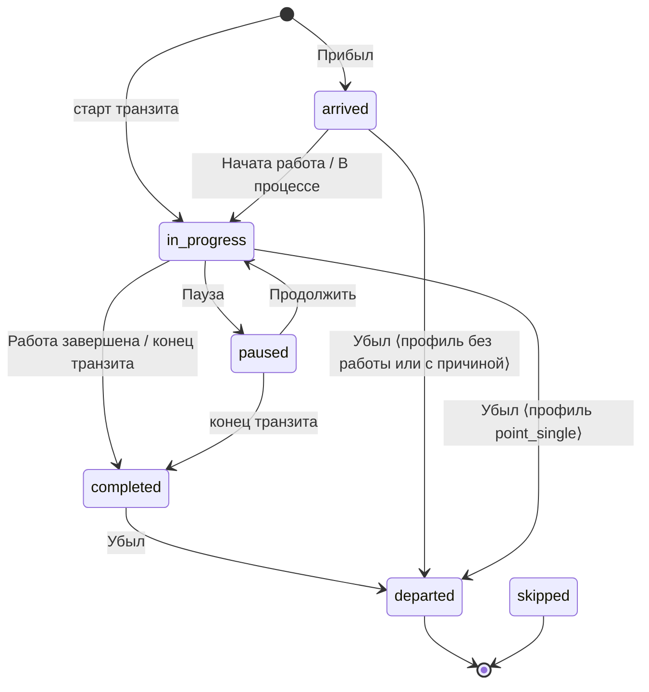
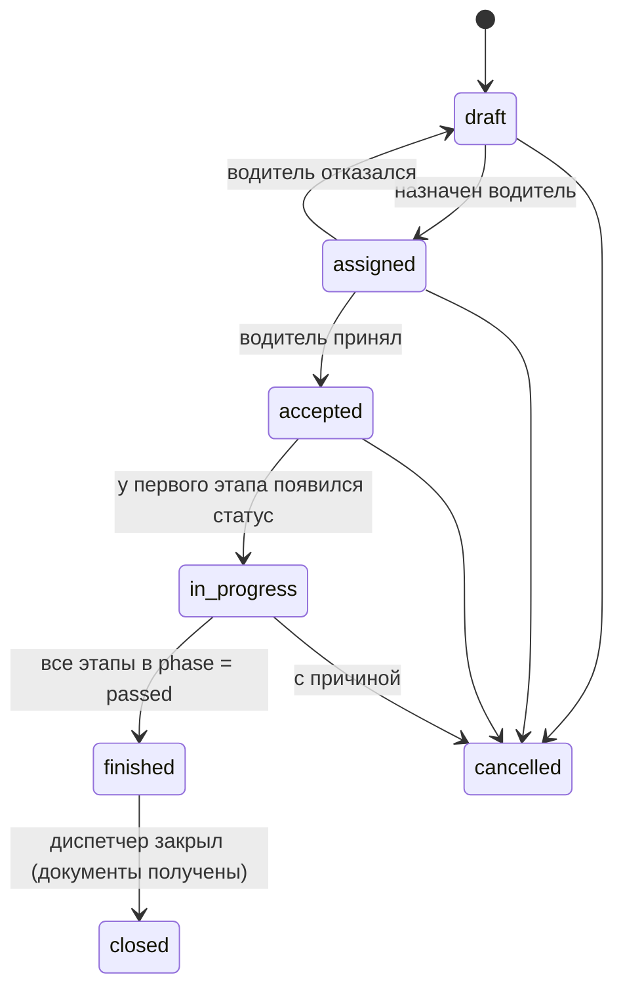

# Этапы, статусы и события

## Рейс — чередование «точек» и «транзитов»

```
[Точка] → (Транзит) → [Точка] → (Транзит) → [Точка] ...
```

- **Точка** (`kind = point`) — место, где что-то происходит: погрузка,
  таможня, граница, порт, выгрузка.
- **Транзит** (`kind = transit`) — движение между двумя точками. Вид
  транзита: `road`, `ferry`, `rail` (контрейлер).

Интеграции присылают только точки, а транзиты между ними сервер вставляет сам.
Между `ferry_port_departure` и `ferry_port_arrival` получится `ferry`, между
ж/д терминалами — `rail`, в остальных случаях — `road`. Транзит можно
передать и явно.

## Главный принцип: статус вычисляется из событий

- **Один автомат статусов для всех этапов.** Точки используют его целиком
  или частично, транзит — урезанную часть.
- Пользователь **не выставляет статус напрямую**. Он выставляет события, а
  статус этапа — результат прогона его событий через автомат в порядке
  `occurred_at`.
- Тип этапа определяет только **набор событий** и **какие статусы ему
  доступны (профиль)**. Компания может добавлять свои типы этапов и события,
  но сам автомат от этого не меняется.

## Словарь статусов

Каждый статус означает **одно и то же на любом этапе**. Ни один статус не
используется в двух смыслах.

| Статус | Что означает | Точка | Транзит |
|---|---|---|---|
| *(нет)* | по этапу ещё не было ни одного события | Впереди | Впереди |
| `arrived` | исполнитель на месте, работа ещё не начата | Прибыл | — |
| `in_progress` | основное действие этапа идёт | В процессе (работа) | В пути (движение) |
| `paused` | основное действие начато, но прервано | Пауза | Остановка |
| `completed` | основное действие этапа завершено | Работа завершена | Завершён (доехал) |
| `departed` | исполнитель покинул точку | Убыл | — |
| `skipped` | этап не выполнялся (решение диспетчера) | Пропущен | Пропущен |

Главное различие: **`completed` относится к работе, `departed` — к месту.**
После «Работа завершена» машина ещё стоит на точке и ждёт документы, пломбу
или выпуск. Это время отдельно видно и считается. У транзита места нет,
поэтому `departed` к нему не применяется: транзит заканчивается на
`completed`.

Для «закончен ли этап» есть отдельное поле **`phase`**, которое выводится из
статуса. Так эти понятия не смешиваются со статусами:

| phase | Когда |
|---|---|
| `ahead` | статуса ещё нет |
| `current` | arrived, in_progress, paused, а также completed у точки |
| `passed` | departed у точки, completed у транзита, skipped |

В каждый момент у рейса ровно один этап в `current`.

## Автомат статусов



## Профили — подмножества одного автомата

| Профиль | Статусы | Цепочка | Для чего |
|---|---|---|---|
| `point_split` | arrived, in_progress, paused, completed, departed | Прибыл → В процессе ⇄ Пауза → Работа завершена → Убыл | погрузка, выгрузка, таможня: видно простой после работы (ждёт документы) |
| `point_single` | arrived, in_progress, paused, departed | Прибыл → В процессе ⇄ Пауза → Убыл | граница, взвешивание, порт, сцепка: конец работы совпадает с убытием |
| `point_simple` | arrived, departed | Прибыл → Убыл | заправка, стоянка, промежуточная точка |
| `transit` | in_progress, paused, completed | В пути ⇄ Остановка → Завершён | любой транзит |

Правило простое: **профиль убирает статусы, а переходы через убранные
статусы «склеиваются»**. Например, в `point_single` нет `completed`, поэтому
«Убыл» идёт прямо из `in_progress`. Код автомата один, он параметризуется
профилем.

## Транзит

- **Старт** — автоматически, тем же событием «Убыл» с предыдущей точки.
  Дорожный транзит стартует в `in_progress` («В пути»), а паром и поезд — в
  `paused` с причиной «ожидание отплытия»: водитель уже на борту, а судно
  стоит. Событие «Отплытие» переводит их в `in_progress`.
- **Пауза** — отдых, пробка, полиция, погода, закрытая дорога, задержка
  парома. Причина указывается в событии.
- **Конец** — автоматически, тем же событием «Прибыл» на следующей точке:
  транзит переходит в `completed`.

То есть водитель транзит отдельно не открывает и не закрывает: внутри него
он отмечает только паузы.

## Границы этапов

| Действие водителя | Текущий этап | Следующий этап |
|---|---|---|
| **Убыл** | точка → `departed` | транзит → `in_progress` (паром / поезд → `paused`) |
| **Прибыл** | транзит → `completed` | точка → `arrived` |

## Что даёт единый автомат: время считается само

Точка:

```
arrived_at ─ ожидание ─ started_at ─ работа (− паузы) ─ completed_at ─ ожидание убытия ─ departed_at
```

Транзит:

```
started_at ─ в пути (− паузы по причинам: отдых / пробка / ...) ─ completed_at
```

Из этих отметок получаются ожидание до начала работы (очередь, простой),
чистое время работы, ожидание после работы (документы, выпуск), время в пути,
время отдыха и вынужденных стоянок.

## События: двигают статус или уточняют его

У каждого типа события есть два ключевых поля:

- **`sets_status`** — в какой статус переводит этап, или пусто;
- **`allowed_in`** — в каких статусах событие можно выставить.

1. **Статусные события** двигают автомат. Для каждого типа этапа у них свои
   формулировки, но статусы под ними общие:

   | Тип этапа | → in_progress | → paused | → completed | → departed |
   |---|---|---|---|---|
   | Погрузка | Начало погрузки | Пауза | Погружен | Убыл |
   | Выгрузка | Начало выгрузки | Пауза | Выгружен | Убыл |
   | Таможня | Подал документы | Задержан | Выпуск | Убыл |
   | Граница | Начат контроль | — | — | Границу пересёк |
   | Порт отправления | Посадка | — | — | На борту |
   | Транзит (дорога) | Продолжил движение | Отдых / Остановка | — | *(Прибыл на след. точку)* |
   | Транзит (паром) | Отплытие | Задержка парома | — | *(Прибыл на след. точку)* |

   Если компании не нужны свои формулировки, у каждого статуса есть
   **универсальное событие**: «Прибыл», «Начата работа», «Пауза»,
   «Продолжить», «Работа завершена», «Убыл».

2. **Уточняющие события** не меняют статус, а добавляют подробности:

   | Статус | Примеры |
   |---|---|
   | arrived | Встал в очередь, Поставлен на рампу, Регистрация в порту, Не попал на рейс |
   | in_progress | Досмотр начат / окончен, Температура рефа, Фото груза, Новое ETA, Заправка |
   | paused | Новое ETA, Фотоотчёт |
   | completed | Документы получены, Пломба установлена |

   Уточняющие события могут быть **требованиями** этапа. Например, с
   погрузки нельзя «Убыл», пока не было события «Документы получены» с фото
   CMR.

## Инциденты — параллельно статусам

Поломка, ДТП, повреждение груза, проблема с документами, отказ рефа. Это
отдельная сущность со своим простым автоматом
`open → acknowledged → resolved`. Её открывает событие водителя, а закрывает
диспетчер.

- Инцидент можно открыть на любом этапе.
- Флаг `blocks_progress`: пока инцидент открыт, нельзя выставить «Убыл».
- Флаг `auto_pause`: открытие инцидента ставит активный этап в `paused`
  (если он в `in_progress`), а решение инцидента возвращает его в
  `in_progress`.

## Автомат рейса

Статус рейса тоже вычисляемый: из статусов этапов и нескольких событий
диспетчера.



## Диспетчер

Механика та же, у диспетчера просто свой перечень событий (`allowed_roles`).
Кроме того, он может:

- выставить статусное событие за водителя с причиной (`forced`), например
  если у водителя сел телефон;
- пропустить этап, у которого ещё нет статуса (`skipped`);
- вставить новую точку после активного этапа: транзиты пересчитаются сами.

## Офлайн: почему вычисляемый статус здесь особенно удобен

Статус — это функция от упорядоченного списка событий. Автомат вынесен в
общий TypeScript-пакет и работает одинаково на сервере и в PWA.

1. Без связи водитель выставляет события, и статус считается на телефоне.
2. Когда события доходят до сервера, они **встают на своё место по
   `occurred_at`**, и статус пересчитывается заново.
3. Если после пересчёта какое-то событие не вписывается в автомат, оно **не
   удаляется**, а помечается `conflict`. Статус считается без него, а
   диспетчер получает задачу разобраться.

Хранимый статус этапа — это только кэш для быстрых запросов. Источник
истины — журнал событий.
