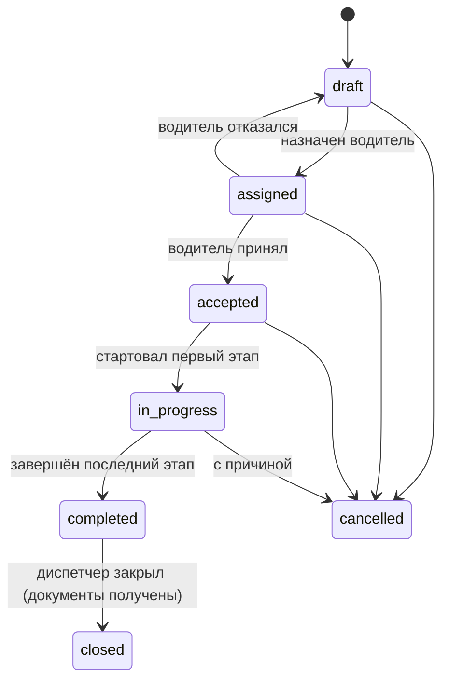
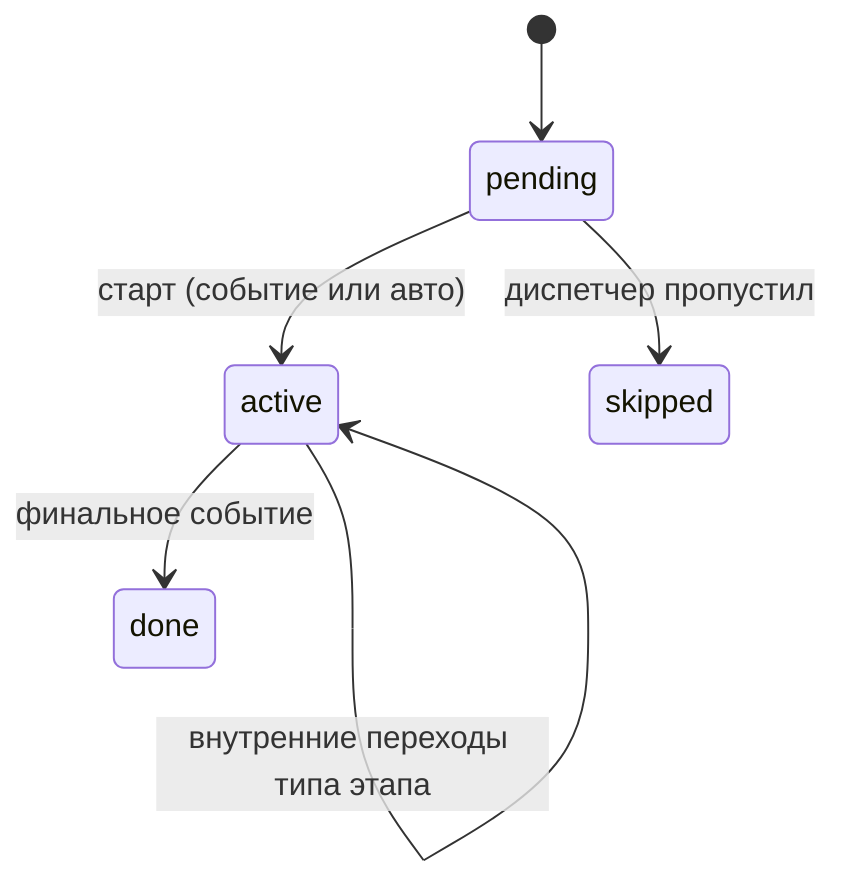
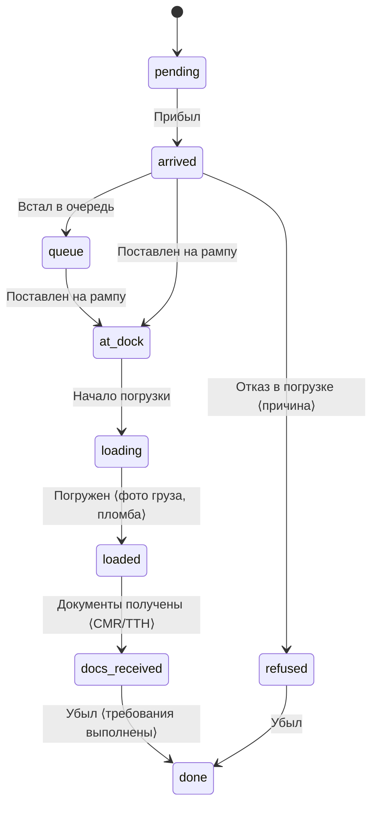
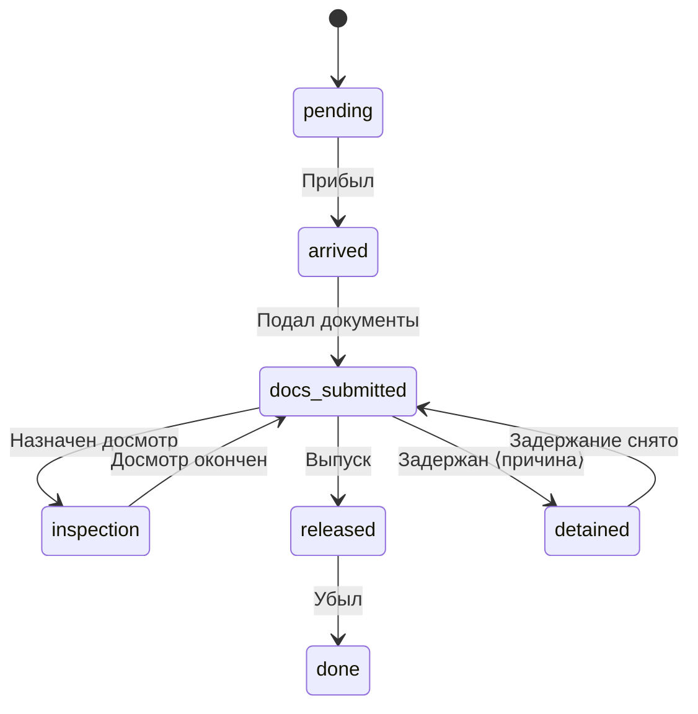
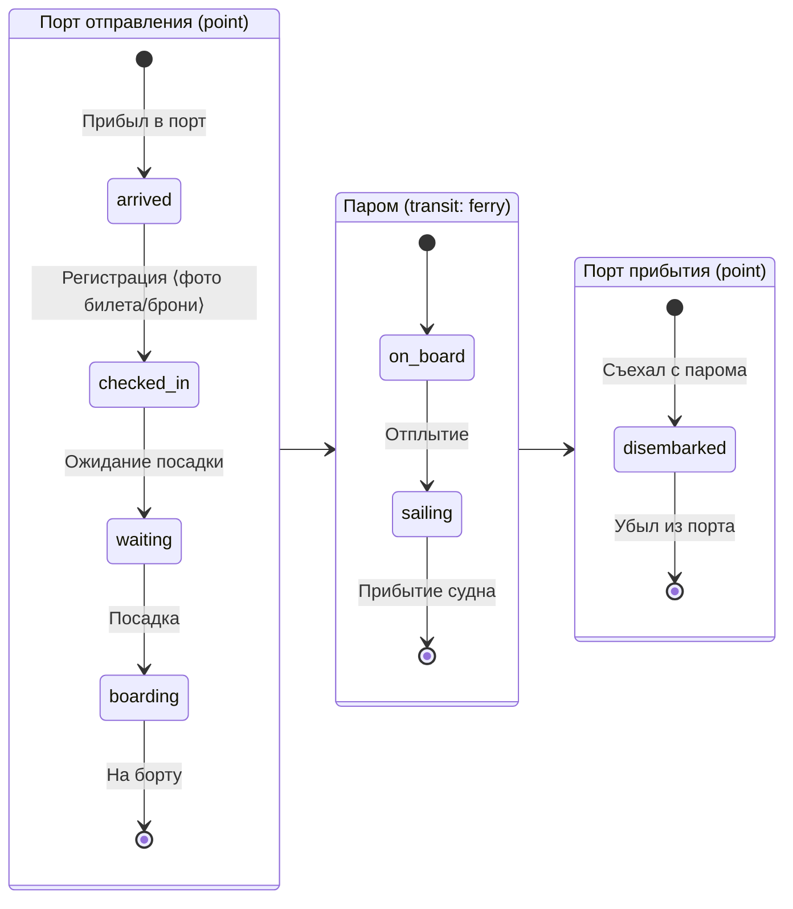
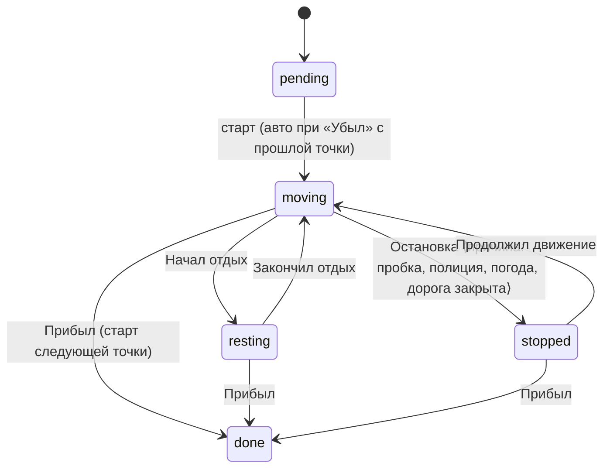

# Этапы перевозки как конечный автомат

## Главная идея: рейс — чередование «точек» и «транзитов»

```
[Точка] → (Транзит) → [Точка] → (Транзит) → [Точка] ...
```

- **Точка** (`kind = point`) — место, где что-то происходит: погрузка,
  таможня, граница, порт, выгрузка.
- **Транзит** (`kind = transit`) — движение между двумя точками. У транзита
  есть **вид**: `road`, `ferry`, `rail` (контрейлер), а также свои состояния
  и события (движение, отдых, остановка, ETA).

Почему так проще:

1. **В каждый момент активен ровно один этап.** Водитель видит только события,
   допустимые из текущего состояния этого этапа, плюс инциденты. Никакого
   «а сейчас я где?».
2. **Границы этапов однозначны.** Событие «Убыл» завершает точку и запускает
   следующий транзит. Событие «Прибыл» завершает транзит и запускает следующую
   точку. Эти события — одна и та же отметка водителя, просто она закрывает
   один этап и открывает другой.
3. **Время считается само:** время в пути — длительность транзита, простой —
   длительность точки, отдых — сумма состояний `resting`.
4. Паром, поезд и любой другой вид перевозки — это просто транзит другого
   вида, а не особый случай.

### Транзиты добавляются автоматически

Интеграции присылают **только точки**, а сервер сам вставляет транзит между
каждой парой соседних точек:

- между `ferry_port_departure` и `ferry_port_arrival` вставляется транзит
  `ferry`;
- между `rail_terminal_departure` и `rail_terminal_arrival` — транзит `rail`;
- во всех остальных случаях — `road`.

Транзиты можно передать и явно, если внешней системе это нужно (например,
плановый пробег или номер рейса парома).

## Три уровня автоматов

| Уровень | Что описывает | Кто двигает |
|---|---|---|
| **Рейс** | общий статус | выводится из этапов и действий диспетчера |
| **Этап** | ход конкретной точки или транзита | события водителя и диспетчера |
| **Инцидент** | поломка, ДТП, повреждение груза и т.п. | открывается событием, закрывается диспетчером |

Инциденты **параллельны** основному потоку: поломка может случиться и на
погрузке, и в пути. Они не ломают автомат этапа, но могут блокировать
переходы (флаг `blocks_progress`). Например, нельзя отметить «Убыл», пока
открыта поломка.

## Автомат рейса



## Автомат этапа: общий каркас

Каждое состояние относится к одной из **категорий**: `pending`, `active`,
`done` или `skipped`. Категории одинаковы для всех типов этапов, поэтому
отчёты, фильтры и API работают единообразно, даже если компания придумала
свои состояния.



Автомат **конкретного типа этапа** — это его состояния внутри `active` и
события-переходы. Он задаётся в справочнике и может быть расширен компанией.

### Погрузка (`loading`)



Выгрузка (`unloading`) устроена так же: `arrived → queue → at_dock →
unloading → unloaded → docs_signed → done`, плюс ветка `claim` (претензия:
недостача или повреждение).

### Таможня (`customs_export`, `customs_import`, `customs_transit_open`, `customs_transit_close`)



### Пересечение границы (`border`)

`pending → arrived → queue → passport_control → customs_control → done
(Границу пересёк)`.

### Паромная переправа

Переправа — это три этапа: порт отправления, транзит `ferry` и порт
прибытия.



Дополнительные ветки:

- **Не попал на рейс** (`missed`): из `waiting` в `checked_in` с перерегистрацией
  на следующий рейс и новым ETA.
- **Рейс парома задерживается или отменён** — информационное событие с новым
  временем, у диспетчера срабатывает предупреждение.
- **Несопровождаемый прицеп.** Водитель сдаёт прицеп в порту
  (`trailer_drop`), другой водитель забирает его в порту прибытия
  (`trailer_pickup`). Поэтому **у этапа может быть свой исполнитель**: по
  умолчанию это водитель рейса, но его можно переназначить. Транзит `ferry`
  без водителя закрывает диспетчер или интеграция с паромной компанией.

Контрейлер по железной дороге (`rail_terminal_*` и транзит `rail`) устроен
так же.

### Транзит по дороге (`transit: road`)



Информационные события в транзите: `eta_update` (новое ETA), `fuel`
(заправка с чеком), `temp_reading` (температура рефа), `photo_report`.

## Типы событий по их действию

| Тип | Что делает | Примеры |
|---|---|---|
| **Переход** (`transition`) | меняет состояние этапа | Прибыл, Начало погрузки, Убыл |
| **Информационное** (`info`) | ничего не меняет, пишется в журнал | ETA, температура, фотоотчёт, заметка |
| **Инцидент** (`incident_open` / `incident_close`) | открывает или закрывает параллельный инцидент | Поломка, ДТП, Повреждение груза, Проблема с документами |
| **Системное** (`system`) | генерирует сервер | Опоздание к окну, Долгая стоянка, Нет связи N часов |

Переходы и события диспетчера устроены так же, только у них другие
`allowed_roles`. Диспетчер может выполнить любой переход за водителя
(«принудительно», с причиной), это видно в журнале.

## Охранные условия (guards) перехода

Переход разрешён, только если:

1. текущее состояние этапа входит в `from[]` перехода;
2. автор в `allowed_roles` и является исполнителем этапа (или диспетчером);
3. заполнены обязательные поля события;
4. для переходов с флагом `requires_requirements` выполнены все
   обязательные требования этапа;
5. нет открытых инцидентов с `blocks_progress`.

## Офлайн и конфликты

Автомат вынесен в **общий TypeScript-пакет**, который работает и на сервере,
и в PWA. Поэтому водитель без связи проходит этапы как обычно: переходы
считаются на телефоне и копятся в очереди.

Когда очередь доходит до сервера, события применяются в порядке
`occurred_at`. Если переход стал недопустим (например, диспетчер за это время
изменил маршрут), **событие не отбрасывается**: оно сохраняется со статусом
`conflict`, а диспетчер получает задачу разобраться. Данные водителя никогда
не теряются.

## Изменение маршрута на ходу

- Новую точку можно вставить только **после** активного этапа. Транзиты
  вокруг неё пересчитываются автоматически.
- Завершённые этапы не редактируются.
- Каждое изменение маршрута создаёт событие диспетчера `route_changed` и
  карточку в чате рейса, чтобы водитель её увидел.
