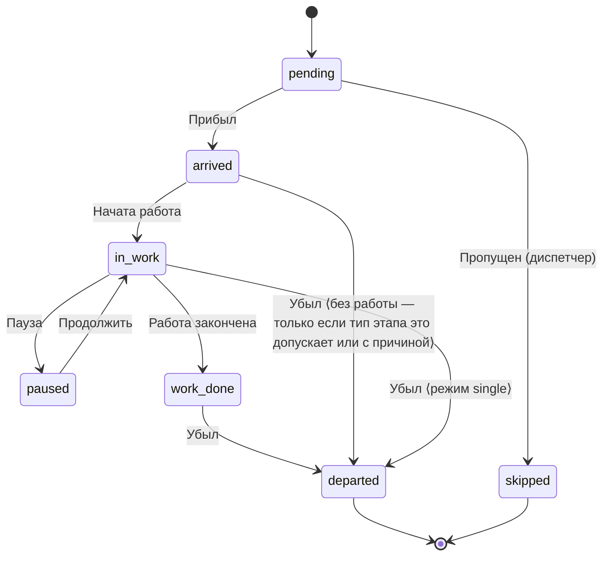
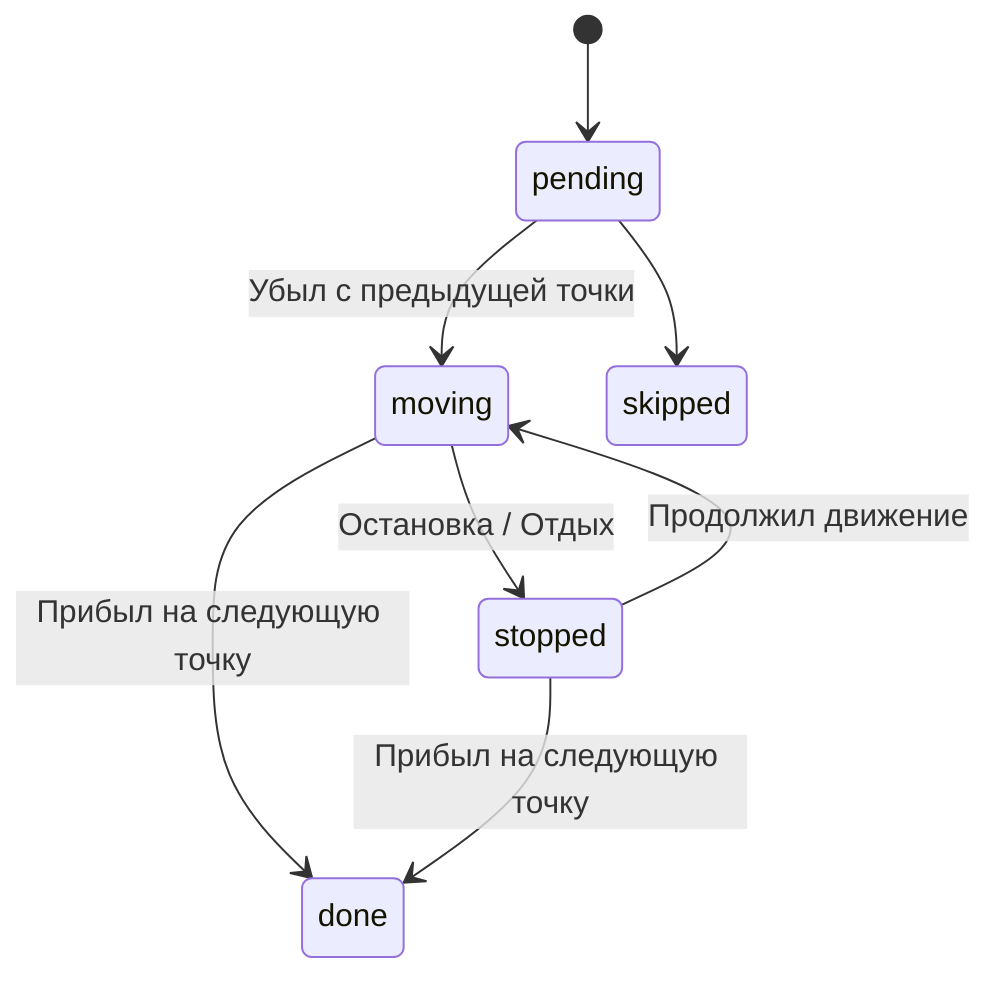
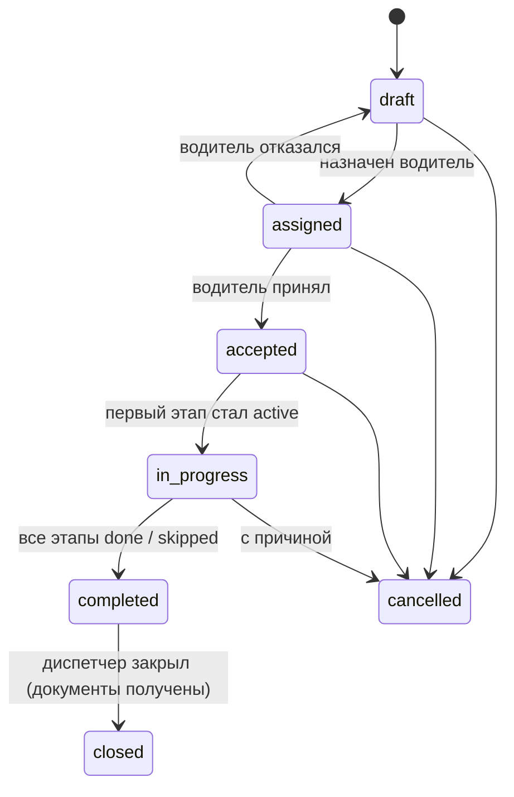

# Этапы, статусы и события

## Рейс — чередование «точек» и «транзитов»

```
[Точка] → (Транзит) → [Точка] → (Транзит) → [Точка] ...
```

- **Точка** (`kind = point`) — место, где что-то происходит: погрузка,
  таможня, граница, порт, выгрузка.
- **Транзит** (`kind = transit`) — движение между двумя точками. Вид
  транзита: `road`, `ferry`, `rail` (контрейлер).

Интеграции присылают только точки, а транзиты между ними сервер вставляет сам.
Между `ferry_port_departure` и `ferry_port_arrival` получится `ferry`, между
ж/д терминалами — `rail`, в остальных случаях — `road`. Транзит можно
передать и явно.

## Главный принцип: статус вычисляется из событий

- У **всех точек один и тот же автомат статусов**, независимо от типа
  (погрузка, таможня, порт…).
- У **всех транзитов** тоже один общий автомат, свой.
- Пользователь **не выставляет статус напрямую**. Он выставляет события, а
  статус этапа — результат «прогона» его событий через автомат в порядке
  `occurred_at`.
- Тип этапа определяет только **набор событий** и **какие из них двигают
  статус**. Компания может добавлять свои типы этапов и события, но автомат
  от этого не меняется. Поэтому отчёты, фильтры, интеграции и интерфейс
  одинаковы для любых настроек.

## Автомат статусов точки



| Статус | Название | Категория |
|---|---|---|
| `pending` | Ожидается | pending |
| `arrived` | Прибыл | active |
| `in_work` | В работе | active |
| `paused` | Пауза | active |
| `work_done` | Работа закончена | active |
| `departed` | Убыл | done |
| `skipped` | Пропущен | skipped |

### Режим работы (`work_mode`) у типа точки

Задаётся в справочнике для каждого типа этапа:

| Режим | Цепочка | Для чего |
|---|---|---|
| `split` | Прибыл → Начата работа → (Пауза) → Работа закончена → Убыл | погрузка, выгрузка, таможня: важно видеть простой **после** окончания работы (ждёт документы) |
| `single` | Прибыл → В процессе → (Пауза) → Убыл | граница, взвешивание, контроль: начало важно, конец совпадает с убытием |
| `none` | Прибыл → Убыл | заправка, стоянка, промежуточная точка |

По умолчанию я бы ставил `split` для погрузки, выгрузки и таможни, а для
остальных `single` или `none`.

### Что даёт единый автомат: время на точке считается само

```
arrived_at ── ожидание ── work_started_at ── работа (− паузы) ── work_finished_at ── ожидание убытия ── departed_at
```

- **Ожидание до начала работы** — очередь, ожидание рампы, это основа для
  претензий по простою.
- **Чистое время работы** — без пауз.
- **Ожидание после работы** — документы, пломба, выпуск.
- **Всего на точке** — с учётом окна прибытия: опоздал или приехал рано.

## Автомат статусов транзита



| Статус | Название |
|---|---|
| `pending` | Ожидается |
| `moving` | В пути |
| `stopped` | Остановка |
| `done` | Завершён |

Причина остановки (отдых, пробка, полиция, погода, закрытая дорога) — поле
события, а не отдельный статус. Так автомат остаётся маленьким, а в отчёте
всё равно видно, сколько было отдыха и сколько вынужденных стоянок.

Для парома и поезда автомат тот же: `moving` означает «судно / поезд в пути»,
`stopped` — «стоим на борту, ждём отплытия или рейс задерживается».
Поэтому стартовый статус зависит от вида транзита: `road` стартует в
`moving`, а `ferry` и `rail` — в `stopped` (причина «ожидание отплытия»).
В `moving` их переводит событие «Отплытие» или «Поезд отправлен».

## Границы этапов: одно событие закрывает один этап и открывает другой

| Действие водителя | Текущий этап | Следующий этап |
|---|---|---|
| **Убыл** | точка → `departed` | транзит → `moving` |
| **Прибыл** | транзит → `done` | точка → `arrived` |

Поэтому в каждый момент у рейса активен ровно один этап.

## События: двигают статус или уточняют его

У каждого типа события есть два ключевых поля:

- **`sets_status`** — в какой статус переводит этап (`arrived`, `in_work`,
  `paused`, `work_done`, `departed`, `moving`, `stopped` …), или пусто;
- **`allowed_in`** — в каких статусах событие можно выставить.

Отсюда два вида событий:

1. **Статусные** — двигают автомат. Для каждого типа этапа это свои слова,
   но под капотом общие статусы:

   | Тип этапа | → in_work | → work_done | → departed |
   |---|---|---|---|
   | Погрузка | Начало погрузки | Погружен | Убыл |
   | Выгрузка | Начало выгрузки | Выгружен | Убыл |
   | Таможня | Подал документы | Выпуск | Убыл |
   | Граница | Начат контроль | — (`single`) | Границу пересёк |
   | Порт отправления | Посадка | — (`single`) | На борту |
   | Порт прибытия | — (`none`) | — | Съехал с парома, убыл |

   Если компания не хочет свои формулировки, у каждого статуса есть
   **универсальное событие** («Прибыл», «Начата работа», «Пауза»,
   «Работа закончена», «Убыл»), доступное на любом этапе.

2. **Уточняющие** — не меняют статус, а добавляют подробности внутри него:

   | Статус | Примеры уточняющих событий |
   |---|---|
   | arrived | Встал в очередь, Поставлен на рампу, Регистрация в порту, Не попал на рейс |
   | in_work | Досмотр начат / окончен, Температура рефа, Фото груза |
   | work_done | Документы получены, Пломба установлена |
   | moving / stopped | Новое ETA, Заправка, Расход, Фотоотчёт |

   Уточняющие события могут быть **требованиями** этапа. Например, переход в
   `departed` с погрузки недоступен, пока не было события «Документы получены»
   с фото CMR.

## Инциденты — параллельно статусам

Поломка, ДТП, повреждение груза, проблема с документами, отказ рефа. Это
отдельная сущность со своим простым автоматом:
`open → acknowledged → resolved`. Её открывает событие водителя, а закрывает
диспетчер.

- Инцидент можно открыть в любом статусе этапа.
- Флаг `blocks_progress`: пока инцидент открыт, нельзя выставить «Убыл».
- Флаг `auto_pause`: открытие инцидента ставит точку на паузу, а транзит
  переводит в `stopped`. Решение инцидента возвращает прежний статус.

## Автомат рейса

Статус рейса тоже **вычисляемый**: из статусов этапов и нескольких событий
диспетчера.



## Диспетчер

Механика та же, у диспетчера просто свой перечень событий (`allowed_roles`).
Кроме того, он может:

- выставить статусное событие за водителя с причиной (`forced`), например
  если у водителя сел телефон;
- пропустить этап (`skipped`);
- вставить новую точку после активного этапа: транзиты пересчитаются сами.

## Офлайн: почему вычисляемый статус здесь особенно удобен

Статус — это функция от упорядоченного списка событий. Автомат вынесен в
общий TypeScript-пакет и работает одинаково на сервере и в PWA.

1. Без связи водитель выставляет события, и статус считается на телефоне.
2. Когда события доходят до сервера, они **встают на своё место по
   `occurred_at`**, и статус пересчитывается заново. Неважно, что пришло
   позже: события диспетчера или запоздавшие события водителя.
3. Если после пересчёта какое-то событие не вписывается в автомат (например,
   «Начало погрузки» после того, как диспетчер пропустил этап), оно **не
   удаляется**, а помечается `conflict`. Статус считается без него, а
   диспетчер получает задачу разобраться.

Хранимый статус этапа — это только кэш для быстрых запросов. Источник
истины — журнал событий.
