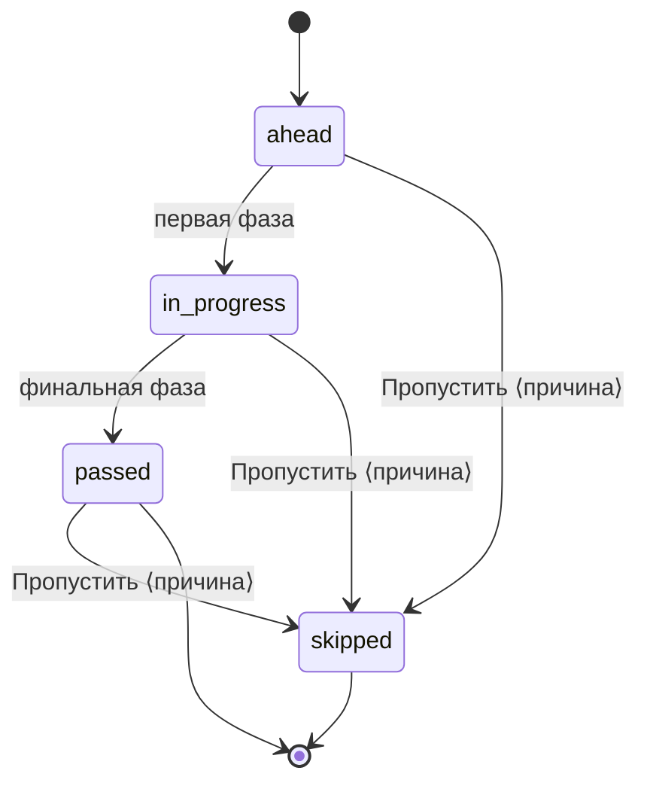
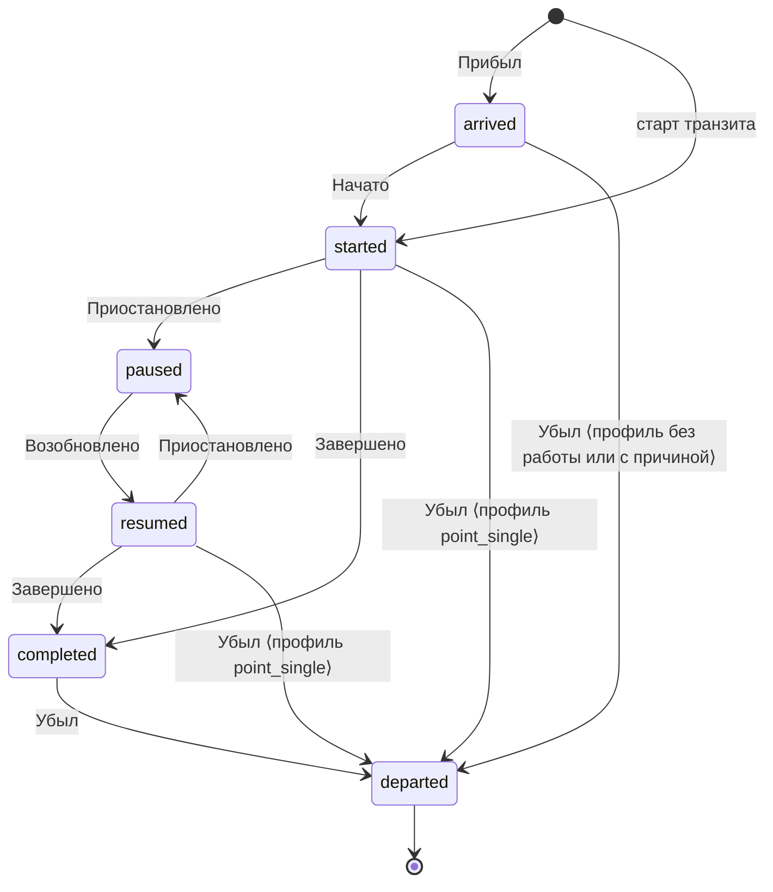
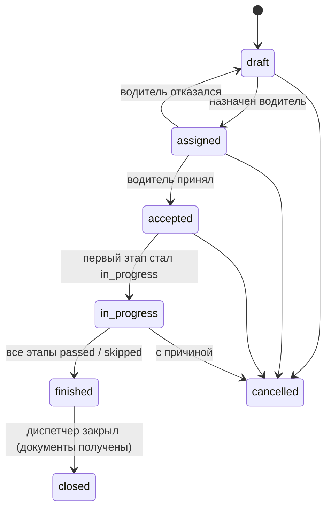

# Этапы: состояние, фаза и события

> **Целевая модель.** Что из неё уже работает в портале — [overview.md](overview.md).

## Рейс — чередование «точек» и «транзитов»

```
[Точка] → (Транзит) → [Точка] → (Транзит) → [Точка] ...
```

- **Точка** (`kind = point`) — место, где что-то происходит: погрузка,
  таможня, граница, порт, выгрузка.
- **Транзит** (`kind = transit`) — движение между двумя точками. Вид
  транзита: `road` или `ferry`.

Интеграции присылают только точки, а транзиты между ними сервер вставляет сам.
Тип транзита один (`transit`), у него есть вид: между `ferry_embark` и
`ferry_disembark` — `ferry`, в остальных случаях — `road`. Между `handover` и
`takeover` транзит не вставляется: груз в это время у третьей стороны.
Список типов точек — в [reference.md](reference.md#типы-точек).

## Два уровня: состояние и фаза

| | Состояние | Фаза |
|---|---|---|
| Отвечает на вопрос | где этап в рейсе? | что на этапе произошло последним? |
| Значения | впереди, в процессе, пройден, пропущен | прибыл, начато, приостановлено, возобновлено, завершено, убыл |
| Природа | положение этапа | **веха — момент**, названа по событию |
| Кто интересуется | список рейсов, отчёты, интеграции | водитель, диспетчер, расчёт простоев |

Оба уровня **вычисляются из событий**. Пользователь не выставляет напрямую ни
состояние, ни фазу: он отмечает события, а система прогоняет их через
автоматы в порядке `occurred_at`. У каждого уровня свой автомат.

### Состояние этапа

| Состояние | Название | Когда |
|---|---|---|
| `ahead` | Впереди | у этапа ещё нет фазы |
| `in_progress` | В процессе | есть фаза, но не финальная |
| `passed` | Пройден | достигнута финальная фаза профиля |
| `skipped` | Пропущен | диспетчер пропустил этап |



- **Впереди → В процессе → Пройден** — только по порядку и только вперёд.
  Вернуться назад или перепрыгнуть через состояние нельзя.
- **Пропущен** — из любого состояния, только диспетчер и только с причиной.
  Фазы, которые уже были у этапа, остаются в журнале.
- Отдельно проверяется **порядок этапов в рейсе**: этап может перейти в
  `in_progress`, только если все предыдущие этапы `passed` или `skipped`. В
  каждый момент у рейса не больше одного этапа `in_progress`.

### Фаза этапа

| Фаза | Название | Точка | Транзит | Отметка времени |
|---|---|---|---|---|
| `arrived` | Прибыл | ✔ | — | `arrived_at` |
| `started` | Начато | ✔ | ✔ | `started_at` |
| `paused` | Приостановлено | ✔ | ✔ | начало паузы |
| `resumed` | Возобновлено | ✔ | ✔ | конец паузы |
| `completed` | Завершено | ✔ | ✔ (финальная) | `completed_at` |
| `departed` | Убыл | ✔ (финальная) | — | `departed_at` |

Фаза — это **последняя достигнутая веха**. Всё, что длится, считается
**между вехами**: от «Прибыл» до «Начато» — ожидание, от «Начато» до
«Завершено» — работа (минус паузы), от «Завершено» до «Убыл» — ожидание
убытия.

## Автомат фаз



У транзита последняя фаза `completed`: после неё переходов нет.

## Профили — подмножества одного автомата

| Профиль | Фазы | Финальная | Для чего |
|---|---|---|---|
| `point_split` | arrived → started ⇄ paused / resumed → completed → departed | departed | погрузка, выгрузка, оформление, сдача, приём: видно ожидание после работы (документы, пломба) |
| `point_single` | arrived → started ⇄ paused / resumed → departed | departed | выезд / въезд через погранпереход, заезд на паром: конец работы совпадает с убытием |
| `point_simple` | arrived → departed | departed | база, съезд с парома, промежуточная точка |
| `point_mark` | departed | departed | быстрый погранпереход: одна кнопка «Пройдено»; закрывается сам при прибытии дальше |
| `transit` | started ⇄ paused / resumed → completed | completed | любой транзит |

Правило простое: **профиль убирает фазы, а переходы через убранные фазы
«склеиваются»**. Например, в `point_single` нет `completed`, поэтому «Убыл»
идёт прямо из `started` или `resumed`. Код автомата один, он
параметризуется профилем.

## Транзит

- **Начато** — автоматически, тем же событием «Убыл» с предыдущей точки
  (для парома это «На борту»).
- **Приостановлено / Возобновлено** — отдых, пробка, полиция, погода,
  закрытая дорога. Причина указывается в событии. На пароме пауз нет:
  отплытие и задержка — уточняющие события, водитель на них не влияет.
- **Завершено** — автоматически, тем же событием «Прибыл» на следующей точке
  (для парома это «Съехал»).

То есть водитель транзит отдельно не открывает и не закрывает: внутри него
он отмечает только паузы.

## Границы этапов

| Действие водителя | Текущий этап | Следующий этап |
|---|---|---|
| **Убыл** | точка: фаза `departed`, состояние `passed` | транзит: фаза `started`, состояние `in_progress` |
| **Прибыл** | транзит: фаза `completed`, состояние `passed` | точка: фаза `arrived`, состояние `in_progress` |

## Время считается само

Точка:

```
arrived_at ─ ожидание ─ started_at ─ работа (− паузы) ─ completed_at ─ ожидание убытия ─ departed_at
```

Транзит:

```
started_at ─ в пути (− паузы по причинам: отдых / пробка / ...) ─ completed_at
```

Из этих отметок получаются ожидание до начала работы (очередь, простой),
чистое время работы, ожидание после работы (документы, выпуск), время в пути,
время отдыха и вынужденных стоянок.

В интерфейсе фаза и длительность показываются вместе, например
«Прибыл 10:42 · ожидание 1 ч 20 мин» или «Приостановлено 14:05 · отдых
45 мин».

## События: двигают фазу или уточняют её

У каждого типа события есть два ключевых поля:

- **`sets_phase`** — какую фазу ставит, или пусто;
- **`allowed_in`** — в каких фазах событие можно выставить.

1. **События фазы** двигают автомат. Для каждого типа этапа у них свои
   формулировки, но фазы под ними общие:

   | Тип этапа | → started | → paused | → resumed | → completed | → departed |
   |---|---|---|---|---|---|
   | Погрузка | Начало погрузки | Пауза | Продолжить | Погружен | Убыл |
   | Выгрузка | Начало выгрузки | Пауза | Продолжить | Выгружен | Убыл |
   | Оформление | Подал документы | Задержан | Задержание снято | Выпуск | Убыл |
   | Сдача / приём | Начало сдачи / приёма | Пауза | Продолжить | Сдано / Принято | Убыл |
   | Граница | Начат контроль | — | — | — | Границу пересёк |
   | Быстрый погранпереход | — | — | — | — | Пройдено |
   | Заезд на паром | Посадка | — | — | — | На борту |
   | Транзит (дорога) | *(Убыл с пред. точки)* | Отдых / Остановка | Продолжил движение | *(Прибыл на след. точку)* | — |

   Если компании не нужны свои формулировки, у каждой фазы есть
   **универсальное событие**: «Прибыл», «Начато», «Приостановлено»,
   «Возобновлено», «Завершено», «Убыл».

2. **Уточняющие события** не меняют фазу, а добавляют подробности:

   | Фаза | Примеры |
   |---|---|
   | arrived | Встал в очередь, Поставлен на рампу, Регистрация в порту, Не попал на рейс |
   | started, resumed | Досмотр начат / окончен, Температура рефа, Фото груза, Новое ETA, Заправка, Отплытие парома |
   | paused | Новое ETA, Фотоотчёт |
   | completed | Документы получены, Пломба установлена |

   Где событие доступно и что оно требует от водителя, опишем отдельно,
   вместе с приложением водителя.

## Инциденты — параллельно фазам

Поломка, ДТП, повреждение груза, проблема с документами, отказ рефа. Это
отдельная сущность со своим простым автоматом
`open → acknowledged → resolved`. Её открывает событие водителя, а закрывает
диспетчер.

- Инцидент можно открыть на любом этапе.
- Флаг `blocks_progress`: пока инцидент открыт, нельзя выставить «Убыл».
- Флаг `auto_pause`: открытие инцидента переводит этап в фазе `started` или
  `resumed` в `paused`, а решение инцидента ставит `resumed`.

## Состояние рейса

Состояние рейса вычисляется из состояний этапов и нескольких событий
диспетчера.



## Диспетчер

Механика та же, у диспетчера просто свой перечень событий (`allowed_roles`).
Кроме того, он может:

- выставить событие фазы за водителя с причиной (`forced`), например если у
  водителя сел телефон;
- пропустить этап в любом состоянии (`skipped`) с причиной;
- вставить новую точку после текущего этапа: транзиты пересчитаются сами.

## Офлайн: почему вычисление из событий здесь особенно удобно

Фаза и состояние — это функция от упорядоченного списка событий. Автомат вынесен
в общий TypeScript-пакет и работает одинаково на сервере и в PWA.

1. Без связи водитель отмечает события, и фаза считается на телефоне.
2. Когда события доходят до сервера, они **встают на своё место по
   `occurred_at`**, и всё пересчитывается заново.
3. Если после пересчёта какое-то событие не вписывается в автомат, оно **не
   удаляется**, а помечается `conflict`. Фаза считается без него, а
   диспетчер получает задачу разобраться.

Хранимые состояние и фаза — это только кэш для быстрых запросов. Источник
истины — журнал событий.

## Автоматы в админке

Автоматы — ядро продукта, поэтому в админке для них есть отдельный раздел
**«Автоматы»**. Схемы в нём **строятся из того же кода**, по которому
работают сервер и PWA, а не рисуются вручную. Расхождения между «как
нарисовано» и «как работает» быть не может.

Что в разделе:

1. **Автомат состояний этапа** и **автомат состояний рейса** — схемы
   переходов с описанием каждого состояния.
2. **Автомат фаз по профилям.** Выбираешь профиль и видишь, какие фазы и
   переходы в нём есть, а какие склеены.
3. **Карта типа этапа.** Выбираешь тип (например, «Погрузка») и видишь его
   автомат фаз, где на каждом переходе подписаны:
   - события, которые его выполняют, с формулировками этого типа;
   - кто может их выставить (роли);
   - требования к переходу (например, перед «Убыл»: фото процесса ≥ 3,
     пломба, CMR);
   - уточняющие события, доступные в каждой фазе.
4. **Проверка настроек.** При изменении справочников подсвечиваются
   проблемы: фаза, в которую нельзя попасть ни одним событием; требование,
   которое нечем выполнить; событие, которое нигде не доступно.
5. **Симулятор.** Собираешь рейс (точки, профили, требования) и
   прокликиваешь события от имени водителя или диспетчера. Видно, как меняются
   фаза и состояние, какие кнопки доступны и что блокирует переход. Это же
   удобно для обучения диспетчеров.
6. **Просмотр конкретного рейса** поверх схемы: пройденный путь подсвечен,
   у каждой фазы стоят время и длительность, конфликтные события отмечены.